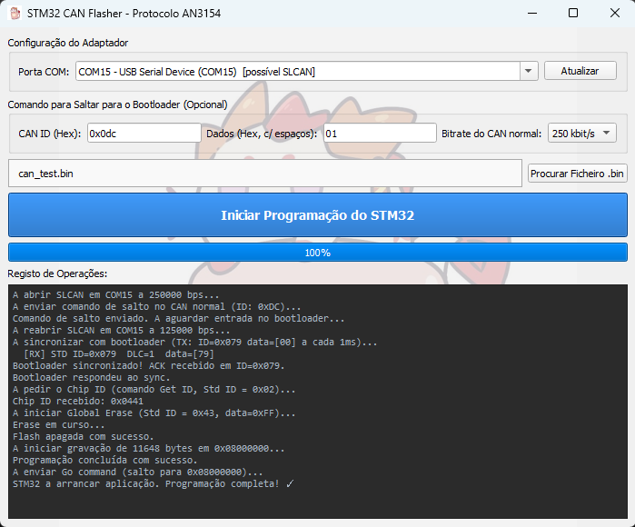

# STM32 CAN Bootloader Programmer

A Python GUI tool to program STM32 microcontrollers over CAN bus with an SLCAN adapter, plus the **LART CAN bootloader** firmware for the **STM32F412** in [`firmware/`](firmware/).

The GUI supports two bootloaders:

| Mode | Bootloader | CAN | Image |
|---|---|---|---|
| **LART** (default) | [`firmware/`](firmware/) in user flash at `0x08000000` | 250 kbit/s, IDs `0x600`/`0x580`, entry `0x601` | Application linked at `0x08010200`, packaged automatically (MCUboot header + SHA-256) |
| **ST ROM — AN3154** | Factory system memory bootloader | 125 kbit/s, AN3154 IDs | Raw binary written at `0x08000000` |

<p align="center">
  
</p>

---

## How It Works

### LART bootloader (recommended)

The bootloader in [`firmware/`](firmware/) splits the F412 flash in half: the first half holds the bootloader and the running application, the second half receives uploads. The GUI (and the CLI [`firmware/tools/can_upload.py`](firmware/tools/can_upload.py), which the GUI imports) does:

1. **Package** — checks the application's stack/reset vectors (must be linked at `0x08010200`) and wraps the `.bin` with a 512-byte MCUboot header and a SHA-256 TLV. Wrong-address binaries are rejected before touching the bus.
2. **Jump trigger** — sends `ENTER_BOOT` (CAN ID `0x601`, data `01 00 00 00 00 00 00 00`) at the application bitrate. The application writes a RAM flag and resets into the bootloader.
3. **Reconnect at 250 kbps** and poll **INFO** (`0x600` → `0x580`) for up to 30 s.
4. **BEGIN** — the bootloader erases the upload half (the running application is untouched).
5. **DATA** — 4 bytes per frame, every frame acknowledged; the progress bar follows the acknowledged bytes.
6. **END** — CRC-32 check, then the bootloader rereads flash and validates header, vectors and SHA-256 before committing.
7. **RESET** — the bootloader copies the committed image into the application slot, verifies the copy and starts it. A power cut during the copy is repaired at the next reset.

While in bootloader mode the board also sends a **heartbeat on `0x581`** every 500 ms (`55`, millisecond tick, bootloader version) and **diagnostic frames on `0x582`–`0x589`** (board type, application version, slot decision and reset flags, upload stage, last error, rejected upload, flash errors). Decode them with the DBC in any CAN tool; the uploader ignores them.

Protocol: [`firmware/docs/CAN_PROTOCOL.md`](firmware/docs/CAN_PROTOCOL.md) · DBC: [`firmware/docs/bootloader.dbc`](firmware/docs/bootloader.dbc) · Bootloader details: [`firmware/README.md`](firmware/README.md) · New application project: [`firmware/docs/APPLICATION_LINKER.md`](firmware/docs/APPLICATION_LINKER.md).

### ST ROM bootloader (AN3154)

STM32 microcontrollers include a factory **system memory bootloader** that listens on CAN at **125 kbps** (entered via BOOT0 or a software jump from the application):

1. **Jump trigger** — configurable frame to the running application (e.g. CAN ID `0x0DC`, data `0x01`).
2. **Reconnect at 125 kbps** and **Sync** (`CAN ID = 0x079`, data `0x00`) until ACK.
3. **Get ID** (`0x02`), **Global Erase** (`0x43`, data `0xFF`).
4. **Write** in 256-byte chunks (`0x31` + data frames on `0x04`), ACK/NACK after every frame.
5. **Go** (`0x21`) to `0x08000000`.

See **AN3154** (*CAN protocol used in the STM32 bootloader*) and **AN2606** (*STM32 microcontroller system memory boot mode*).

---

## Requirements

```bash
pip install -r requirements.txt
```

| Package | Purpose |
|---|---|
| `pyqt5` | GUI framework |
| `python-can` | CAN bus abstraction (SLCAN backend) |
| `pyserial` | Serial port enumeration for SLCAN adapters |
| `cantools` | Encodes/decodes the LART bootloader frames from `firmware/docs/bootloader.dbc`; regenerates the firmware C codec |

The CLI uploader alone needs only [`firmware/tools/requirements.txt`](firmware/tools/requirements.txt) (`python-can`, `cantools`, `pyserial`). Building the bootloader needs the Arm GNU toolchain (bundled with STM32CubeIDE) and CMake/Ninja, or STM32CubeIDE itself.

---

## Usage

```bash
python CAN_STM32_Programmer.py
```

### GUI Fields

| Field | Description |
|---|---|
| **COM Port** | Serial port of your SLCAN adapter (e.g. `COM7`, `/dev/ttyUSB0`). Click **Refresh** to detect. |
| **Bootloader** | **LART** (firmware in this repo) or **ST ROM — AN3154**. Changing it loads that mode's jump defaults. |
| **CAN ID (Hex)** | ID of the jump frame sent to the running application. LART: `0x601`; ROM example: `0x0DC`. |
| **Data (Hex, space-separated)** | Payload of the jump frame. LART: `01 00 00 00 00 00 00 00`; ROM example: `01`. |
| **Bitrate (normal CAN)** | Bitrate of your application CAN bus. The tool switches to 250 kbps (LART) or 125 kbps (ROM) for the bootloader phase. |
| **Firmware file** | `.bin` to flash. LART: the CubeIDE application linked at `0x08010200` (or an already packaged `.mcuboot.bin`); ROM: a binary for `0x08000000`. |

Press **Iniciar Programação do STM32** to start. The log console shows every step in real time.

CLI equivalent for the LART bootloader:

```bash
python firmware/tools/can_upload.py path/to/application.bin --channel COM5
```

---

## Repository Structure

```
.
├── CAN_STM32_Programmer.py      # GUI CAN flasher (LART + AN3154 modes)
├── requirements.txt
├── firmware/                    # LART CAN bootloader for STM32F412RE (STM32CubeIDE + CMake)
│   ├── Core/                    # main.c, boot_port.c (CAN/heartbeat/diagnostics/handoff), boot_update.c (upload/install),
│   │                            #   boot_flash.c, bootloader.c/.h (C codec generated from the DBC)
│   ├── Drivers/                 # STM32F4 HAL, CMSIS, mbed TLS SHA-256 subset
│   ├── MCU_BOOT_F412.ioc        # CubeMX configuration
│   ├── STM32F412RETX_FLASH.ld   # Bootloader linker script (64 KiB)
│   ├── docs/                    # CAN protocol, DBC, uploader, application-linker and porting guides
│   ├── tests/                   # QEMU tests (install logic, heartbeat/diagnostics) and Python tests (uploader, DBC codec)
│   └── tools/                   # can_upload.py (CLI uploader, also used by the GUI), generate_can.py (DBC -> C codec)
├── wiki/
│   ├── CAN_Setup_STM32F412.md   # CAN setup for STM32F412 (ROM and LART bootloaders)
│   └── CAN_Setup_STM32F103CBT6.md
└── support/
    ├── AN3154_CAN_bootloader_protocol.md
    ├── AN2606_system_memory_boot_mode.md
    ├── RM0402_STM32F412_flash.md        # F412 flash sectors used by the LART layout
    ├── MCUboot_image_format.md          # Image format packaged by the uploader
    └── gonzabrusco_jump_to_bootloader.md
```

---

## LART Bootloader (STM32F412RE)

See [`firmware/README.md`](firmware/README.md). Summary:

| Region | Address | Size |
|---|---|---|
| Bootloader | `0x08000000` | 64 KiB (sectors 0–3) |
| Application slot | `0x08010000` (vectors `0x08010200`) | 192 KiB (sectors 4–5) |
| Upload slot | `0x08040000` | 256 KiB (sectors 6–7) |

- HSE 8 MHz → 64 MHz, APB1 32 MHz; **CAN2 on PB5 (RX) / PB13 (TX)** at 250 kbps (prescaler 8, BS1 13 TQ, BS2 2 TQ, sample point 87.5 %).
- Logs on USART2 (PA2/PA3, 115200 8N1); status LED PA5; optional entry button PC13 (active-low).
- Maximum application: 196056 bytes raw (`0x30000` packaged).
- The application must handle `ENTER_BOOT` (`0x601`) by writing `0xB00710AD` to `0x2003FFFC` and resetting — see [porting step 9](firmware/docs/PORTING.md#step-9--add-requestbootloader-to-the-application). Link it at `0x08010200` as described in [APPLICATION_LINKER.md](firmware/docs/APPLICATION_LINKER.md).
- Heartbeat `0x581` and diagnostics `0x582`–`0x589`; bootloader version 1.0.0, board type 2. Reserve `0x580`–`0x589`, `0x600`, `0x601` on the bus.

---

## Wiki

- [STM32F412 CAN Setup](wiki/CAN_Setup_STM32F412.md) — Dual CAN, filter banks, LART bootloader entry, ROM jump, transceiver wiring
- [STM32F103CBT6 CAN Setup](wiki/CAN_Setup_STM32F103CBT6.md) — Single CAN, pin remapping, bootloader address differences

---

## Support / References

- [AN3154 — CAN protocol used in the STM32 bootloader](support/AN3154_CAN_bootloader_protocol.md)
- [AN2606 — STM32 microcontroller system memory boot mode](support/AN2606_system_memory_boot_mode.md)
- [RM0402 — STM32F412 flash organisation](support/RM0402_STM32F412_flash.md)
- [MCUboot image format](support/MCUboot_image_format.md)
- [How to Jump to the STM32 Bootloader and Return to the Application (gonzabrusco)](support/gonzabrusco_jump_to_bootloader.md)

---

## Hardware Setup

```
  STM32F412 Board       CAN Transceiver       SLCAN Adapter        PC
  ┌──────────────┐      ┌─────────────┐      ┌────────────┐      ┌──────┐
  │ CAN2_TX PB13 ├─────►│ TXD    CANH ├──────┤ CAN H      │      │      │
  │ CAN2_RX PB5  │◄─────┤ RXD    CANL ├──────┤ CAN L      ├──────┤ USB  │
  │ GND          ├──────┤ GND         │      │            │      │      │
  └──────────────┘      └─────────────┘      └────────────┘      └──────┘
```

> STM32 CAN pins are logic signals: always use a transceiver (e.g. MCP2562). Add a 120 Ω termination resistor at each end of the bus if your adapter does not include one. Both bootloaders use PB5/PB13 (CAN2) on the STM32F412.

---
